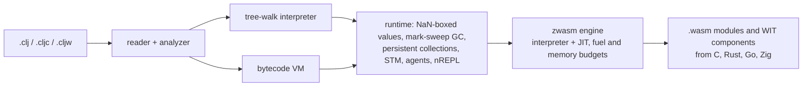
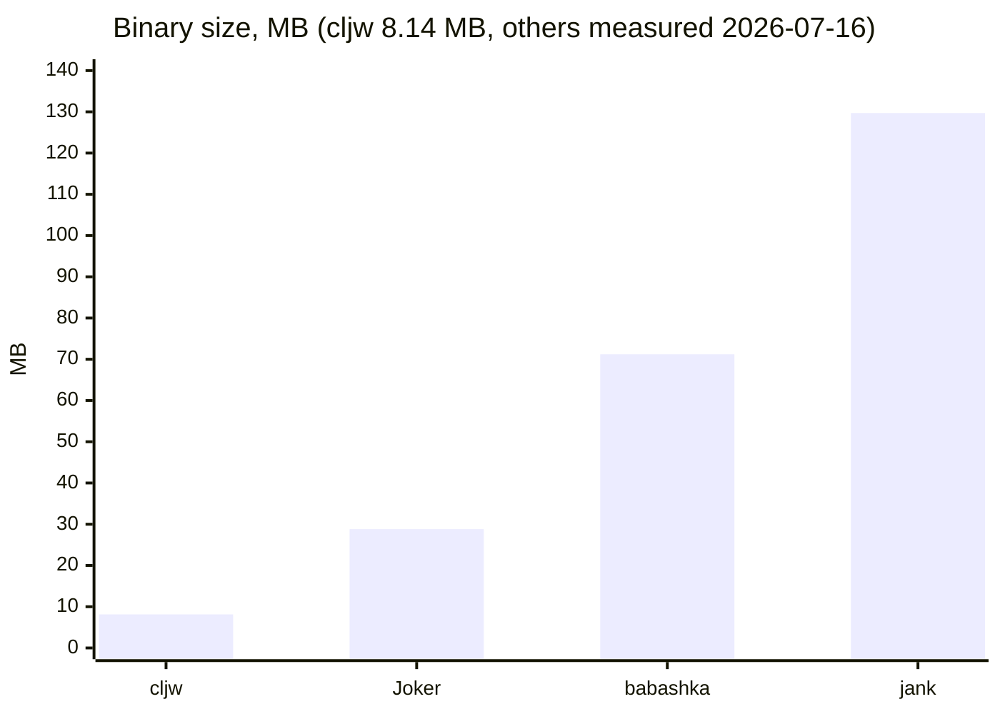
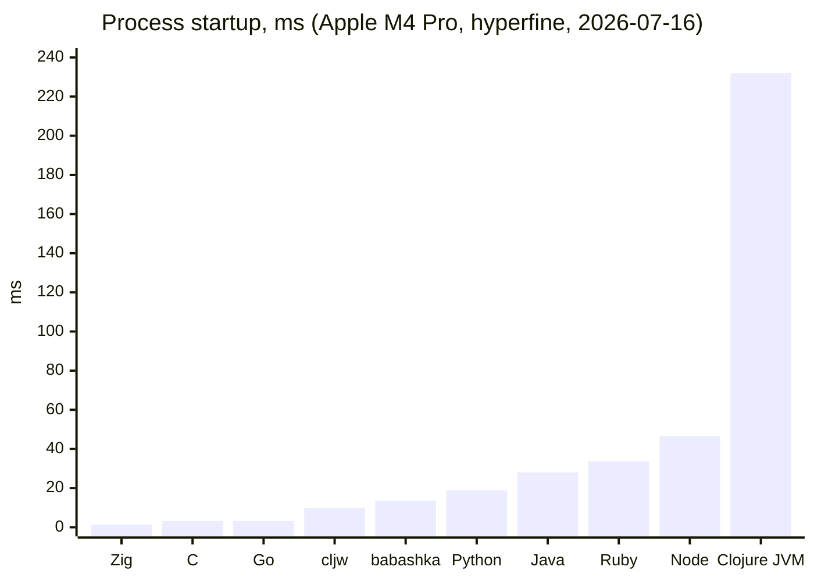
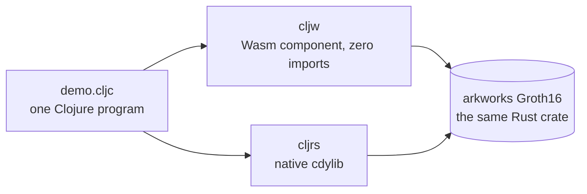

<p align="center">
  
  &nbsp;&nbsp;&nbsp;
  <a href="https://github.com/BuddhiLW"></a>
</p>

<h1 align="center">ClojureWasm</h1>

<p align="center">
  <em>A JVM-free Clojure runtime in Zig. One 8.1 MB binary, a Wasm FFI, and a sandbox per module.</em>
</p>

<p align="center">
  <a href="https://github.com/BuddhiLW/ClojureWasm/releases/latest"></a>
  <a href="https://github.com/BuddhiLW/ClojureWasm/actions/workflows/ci.yml"></a>
  <a href="https://github.com/BuddhiLW/homebrew-tap"></a>
  <a href="https://ziglang.org/"></a>
  <a href="./LICENSE"></a>
</p>

<p align="center">
  <a href="#install">Install</a> ·
  <a href="#call-c-from-clojure">Call C from Clojure</a> ·
  <a href="#how-it-works">How it works</a> ·
  <a href="#numbers">Numbers</a> ·
  <a href="#where-it-fits">Where it fits</a> ·
  <a href="#what-runs">What runs</a> ·
  <a href="#documentation">Docs</a>
</p>

`cljw` runs Clojure without a JVM. It ships as one static binary, starts in
milliseconds, and embeds a WebAssembly engine: a `.wasm` built from C, Rust,
Go or Zig loads like a library and runs inside a sandbox whose fuel and memory
you set.

## Install

```sh
brew install buddhilw/tap/cljw                # macOS arm64, Linux x86_64
zig build -Dwasm -Doptimize=ReleaseSafe       # or from source (Zig 0.16)
```

Prebuilt binaries are on [Releases](https://github.com/BuddhiLW/ClojureWasm/releases).
They are not code-signed; on macOS, `xattr -d com.apple.quarantine "$(which cljw)"`
once.

```sh
cljw -e '(->> (range) (filter even?) (take 5))'   # (0 2 4 6 8)
cljw script.clj                                    # run a file
cljw                                               # REPL
cljw nrepl --port 7888                             # nREPL, CIDER-compatible
cljw build script.clj -o app                       # self-contained native binary
```

## Call C from Clojure

A C function, compiled to Wasm, called with ordinary Clojure interop.

```c
// docs/examples/polyglot/c/kernel.c
EXPORT("sum_f64") double sum_f64(int off, int n) {
    const double *p = (const double *)(long)off;
    double s = 0.0;
    for (int i = 0; i < n; i++) s += p[i];
    return s;
}
```

```sh
zig cc -target wasm32-freestanding -O2 -nostdlib \
  -Wl,--no-entry -Wl,--export-memory -Wl,-z,stack-size=65536 kernel.c -o kernel.wasm
```

```clojure
(def k (wasm/load "docs/examples/polyglot/c/kernel.wasm" {:fuel 1000000 :max-memory-pages 16}))

(mapv :name (wasm/exports k))     ;=> ["memory" "buf_addr" "buf_cap" "sum_f64" "scale_f64"]

(def buf (.buf_addr k))
(wasm/mem-write! k :f64 buf [1.0 2.0 3.0 4.0])
(.sum_f64 k buf 4)                 ;=> 10.0
```

`wasm/exports` and the dot form need v1.15.1 or later; `(wasm/call k "sum_f64"
buf 4)` works on every version. A guest fault is a catchable
exception, never a host crash, and a guest that runs out of fuel stops with an
error while your process keeps going.

A WIT component goes further: it is required like a namespace, and records,
lists and `result<T, E>` cross as plain Clojure data.

```clojure
(ns my.app (:require ["./typed_payload.wasm" :as tp]))   ; Rust + wit-bindgen

(tp/process {:xs [3 4 5] :label "data"})   ;=> [:ok {:xs [3 4 5 12], :label "data!"}]
(tp/process {:xs [] :label "fail"})        ;=> [:err "boom: fail"]
```

| guest | crosses the boundary as | entry point |
|---|---|---|
| C, Zig, Rust `no_std` | scalars, arrays in guest memory | `wasm/load`, `wasm/call`, `(.f m args)`, `wasm/mem-*` |
| Rust + wit-bindgen | records, lists, strings, results | `(:require ["x.wasm" :as x])` |
| Go (`wasip1`) | argv, env, stdin, stdout, exit code | `wasm/run` |

All of them build and run in [`docs/examples/polyglot`](./docs/examples/polyglot/README.md),
rebuilt from source by CI on every push.

## How it works



Two backends evaluate the same analyzer output, and every test runs on both:
a mismatch fails the build. [`docs/architecture.md`](./docs/architecture.md)
has the map.

## Numbers





- Persistent collections trade wins with JVM Clojure op by op: map `assoc`
  3.9× faster, vector `conj` 4.4× slower ([measured](./docs/works/collection_performance.md)).
- Tight numeric loops are the JVM's: about 45 ns per empty iteration here
  against 2 ns under its JIT. Put a hot kernel in a Wasm guest.
- In a guest, the engine runs 2× to 3× behind wasmtime, and one call costs
  about 1 µs ([bench](./bench/README.md)).

The release size is checked against the built binary on every push.

## Where it fits

- **Untrusted code in-process.** Plugins, MCP tool servers, handlers that run
  user code: a module sees only what you pass it, under a fuel and memory budget.
- **Other languages' libraries.** Reach Rust, C, Go or Zig code through Wasm
  instead of a JVM.
- **Existing native tools.** `clojure.java.shell/sh` runs a binary by argv and
  returns `{:exit :out :err}`, as on the JVM and babashka.
- **Short-lived processes.** CLIs, scripts and serverless handlers that pay
  for startup thousands of times a day.
- **One program, two runtimes.** A host-free `.cljc` runs unchanged on the
  JVM, on `cljw` and on its Rust-hosted sibling
  [clojurust](https://github.com/BuddhiLW/clojurust) (`cljrs`).



| Groth16 over BN254, same crate | cljrs (native) | cljw (Wasm) |
|---|---|---|
| proof, verify | 128 bytes, true / false | 128 bytes, true / false |
| wall time | 1.29 s (debug build) | 9.17 s |
| env vars / file read / clock | 212 / granted / granted | 0 / denied / trap |

Confinement or speed, chosen per deployment, without a rewrite.

## What runs

`clojure.core` and the everyday library (`string`, `set`, `walk`, `zip`,
`edn`, `data.json`, `data.csv`, `pprint`, `test`, `spec`, `tools.cli` and more),
STM, agents, futures, real threads, transducers, protocols, records,
multimethods, `deftype` / `reify` and the full numeric tower. `deps.edn` with
`:local/root`, `:git` and `:mvn/version` coordinates; libraries such as malli,
hiccup, honeysql and test.check load today ([ladder](./docs/works/ladder.md)).

Not yet: `core.async`, `java.time.format`, and a strict `clojure.edn` reader.
JVM-only interop (`gen-class`, `proxy` over arbitrary classes, reflection) is
out of scope by design. Details:
[`docs/clojure_vs_clojurewasm.md`](./docs/clojure_vs_clojurewasm.md).

## Documentation

[`docs/`](./docs/README.md) ·
[CHANGELOG](./CHANGELOG.md) ·
[vs JVM Clojure](./docs/clojure_vs_clojurewasm.md) ·
[landscape](./docs/landscape.md) ·
[testing](./docs/testing.md) ·
[demos](./docs/works/demos.md) ·
[roadmap](./.dev/ROADMAP.md)

Issues and PRs are welcome at
[BuddhiLW/ClojureWasm](https://github.com/BuddhiLW/ClojureWasm/issues); the most
useful report is Clojure code that behaves differently here than on the JVM.

## License and credit

Eclipse Public License 2.0 ([LICENSE](./LICENSE), [NOTICE](./legal/NOTICE)).

Created by [Shota Kudo (@chaploud)](https://github.com/chaploud), who built it
from nothing to a working JVM-free Clojure with a Wasm FFI through v1.10.1. In
2026-10 the project passed to [@BuddhiLW](https://github.com/BuddhiLW); the
fork's work (v1.11 to v1.15.0) is merged back into
[clojurewasm/ClojureWasm](https://github.com/clojurewasm/ClojureWasm), while
releases and the Homebrew tap publish from
[BuddhiLW/ClojureWasm](https://github.com/BuddhiLW/ClojureWasm). The engine is
[zwasm](https://github.com/zwasm/zwasm).
